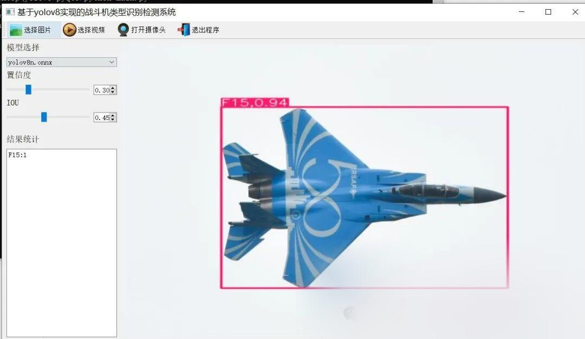
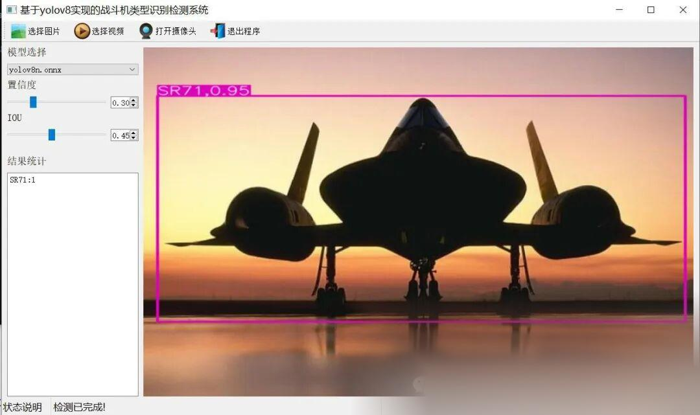
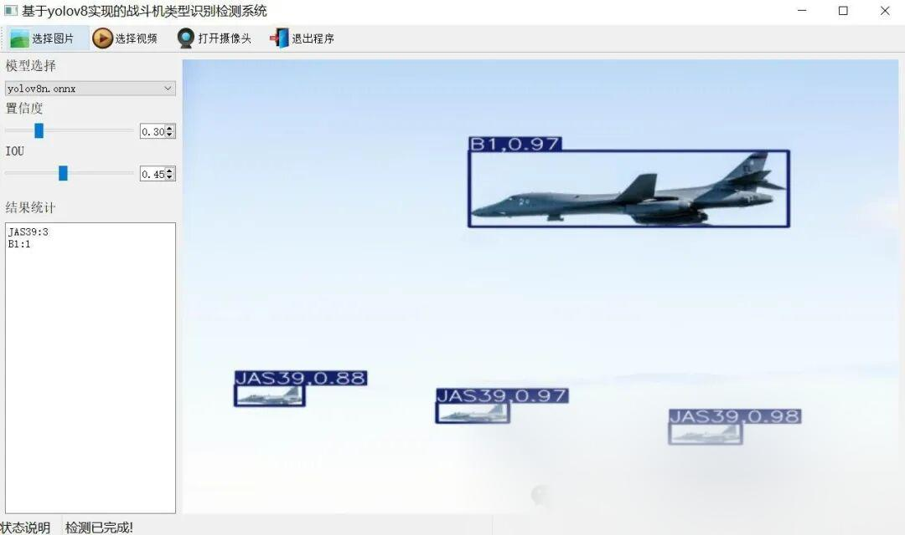

# Aircraft Type Recognition Detection System Based on Yolov8 in Python Source Code + ONNX Model + Evaluation Indicator Curve + High-quality GUI Interface

[Algorithm Introduction]

YOLOv8 is the latest generation of object detection model launched by Ultralytics, which demonstrates unprecedented advanced performance in the field of target detection. The fighter jet type identification detection system based on YOLOv8 achieves rapid and accurate recognition of fighter jet images through the combination of deep learning technology and convolutional neural network (CNN).

The system can process the input fighter jet images or video frames in real-time. Through the powerful capabilities of the YOLOv8 model, it automatically detects the image, predicts the bounding box, and provides the probability of the specific type of fighter jet. The advantage of YOLOv8 lies in its efficient single forward pass mechanism, which can achieve high accuracy while maintaining extremely fast processing speed, making it very suitable for applications with high real-time requirements.

In practical applications, this system can be widely used in military reconnaissance and airspace monitoring. For example, by using aerial images captured by drones, the system can quickly identify the type of fighter jets, providing important intelligence support for military operations. Additionally, this system can be integrated with Geographic Information Systems (GIS) to further enhance the precision and real-time accuracy of target recognition.

In summary, the fighter aircraft type recognition detection system based on YOLOv8 has broad application prospects in military and civil fields with its high efficiency and accuracy.

[Effect Display]







[Test Environment]

windows10
anaconda3+python3.8
torch==1.9.0+cu111
ultralytics==8.2.95

The model can detect the category.

-
-
-
-
-
-
-
-
-
-
-
-
-
-
-
-
-
-
-
-
-
-
-
-
-
-
-
-
-
-
-
-
-
-
-
-
-
-
-
-
-
-
-

```
A10A400MAG600AV8BB1B2B52Be200C130C17C2C5E2E7EF2000F117F14F15F16F18F22F35F4J20JAS39MQ9Mig31Mirage2000P3RQ4RafaleSR71Su34Su57TornadoTu160Tu95U2US2V22VulcanXB70YF23
```

[Training Information]

| Parameter | Value |
| ----------- | -------- |
| Training set images count | 7070 |
| Validation set images count | 2020 |
| Training map | 71.4% |
| Training precision (Precision) | 76.0% |
| Training recall (Recall) | 61.1% |

### Average Precision (MAP) (0.5)

|

Category

 ||

MAP0.5 (unit:%)

 |
|

all

 ||

71%

 |
|

A10

 ||

66%

 |
|

A400M

 ||

78%

 |
|

AG600

 ||

87%

 |
|

AV8B

 ||

80%

 |
|

B1

 ||

65%

 |
|

B2

 ||

84%

 |
|

B52

 ||

83%

 |
|

Be200

 ||

83%

 |
|

C130

 ||

76%

 |
|

C17

 ||

65%

 |
|

C2

 ||

92%

 |
|

C5

 ||

85%

 |
|

E2

 ||

80%

 |
|

E7

 ||

81%

 |
|

EF2000

 ||

39%

 |
|

F117

 ||

54%

 |
|

F14

 ||

53%

 |
|

F15

 ||

60%

 |
|

F16

 ||

60%

 |
|

F18

 ||

66%

 |
|

F22

 ||

51%

 |
|

F35

 ||

54%

 |
|

F4

 ||

71%

 |
|

J20

 ||

64%

 |
|

JAS39

 ||

57%

 |
|

MQ9

 ||

79%

 |
|

Mig31

 ||

81%

 |
|

Mirage2000

 ||

77%

 |
|

P3

 ||

70%

 |
|

RQ4

 ||

70%

 |
|

Rafale

 ||

60%

 |
|

SR71

 ||

80%

 |
|

Su34

 ||

80%

 |
|

Su57

 ||

62%

 |
|

Tornado

 ||

70%

 |
|

Tu160

 ||

69%

 |
|

Tu95

 ||

75%

 |
|

U2

 ||

70%

 |
|

US2

 ||

88%

 |
|

V22

 ||

74%

 |
|

Vulcan

 ||

69%

 |
|

XB70

 ||

82%

 |
|

YF23

 ||

81%

 |

[Training Dataset]
[Partial Implementation Source Code]

-
-
-
-
-
-
-
-
-
-
-
-
-
-
-
-
-
-
-
-
-
-
-
-
-
-
-
-
-
-
-
-
-
-
-
-
-
-
-
-
-
-
-
-
-
-
-
-
-
-
-
-
-
-
-
-
-
-
-
-
-
-
-
-
-
-
-
-
-
-
-
-
-
-
-
-
-
-
-
-
-
-
-
-
-
-
-
-
-
-
-
-
-
-
-
-
-
-
-
-
-
-
-
-
-
-
-
-

```
class Ui_MainWindow(QtWidgets.QMainWindow):    signal = QtCore.pyqtSignal(str, str)     def setupUi(self):        self.setObjectName("MainWindow")        self.resize(1280, 728)        self.centralwidget = QtWidgets.QWidget(self)        self.centralwidget.setObjectName("centralwidget")         self.weights_dir = './weights'         self.picture = QtWidgets.QLabel(self.centralwidget)        self.picture.setGeometry(QtCore.QRect(260, 10, 1010, 630))        self.picture.setStyleSheet("background:black")        self.picture.setObjectName("picture")        self.picture.setScaledContents(True)        self.label_2 = QtWidgets.QLabel(self.centralwidget)        self.label_2.setGeometry(QtCore.QRect(10, 10, 81, 21))        self.label_2.setObjectName("label_2")        self.cb_weights = QtWidgets.QComboBox(self.centralwidget)        self.cb_weights.setGeometry(QtCore.QRect(10, 40, 241, 21))        self.cb_weights.setObjectName("cb_weights")        self.cb_weights.currentIndexChanged.connect(self.cb_weights_changed)         self.label_3 = QtWidgets.QLabel(self.centralwidget)        self.label_3.setGeometry(QtCore.QRect(10, 70, 72, 21))        self.label_3.setObjectName("label_3")        self.hs_conf = QtWidgets.QSlider(self.centralwidget)        self.hs_conf.setGeometry(QtCore.QRect(10, 100, 181, 22))        self.hs_conf.setProperty("value", 25)        self.hs_conf.setOrientation(QtCore.Qt.Horizontal)        self.hs_conf.setObjectName("hs_conf")        self.hs_conf.valueChanged.connect(self.conf_change)        self.dsb_conf = QtWidgets.QDoubleSpinBox(self.centralwidget)        self.dsb_conf.setGeometry(QtCore.QRect(200, 100, 51, 22))        self.dsb_conf.setMaximum(1.0)        self.dsb_conf.setSingleStep(0.01)        self.dsb_conf.setProperty("value", 0.25)        self.dsb_conf.setObjectName("dsb_conf")        self.dsb_conf.valueChanged.connect(self.dsb_conf_change)        self.dsb_iou = QtWidgets.QDoubleSpinBox(self.centralwidget)        self.dsb_iou.setGeometry(QtCore.QRect(200, 160, 51, 22))        self.dsb_iou.setMaximum(1.0)        self.dsb_iou.setSingleStep(0.01)        self.dsb_iou.setProperty("value", 0.45)        self.dsb_iou.setObjectName("dsb_iou")        self.dsb_iou.valueChanged.connect(self.dsb_iou_change)        self.hs_iou = QtWidgets.QSlider(self.centralwidget)        self.hs_iou.setGeometry(QtCore.QRect(10, 160, 181, 22))        self.hs_iou.setProperty("value", 45)        self.hs_iou.setOrientation(QtCore.Qt.Horizontal)        self.hs_iou.setObjectName("hs_iou")        self.hs_iou.valueChanged.connect(self.iou_change)        self.label_4 = QtWidgets.QLabel(self.centralwidget)        self.label_4.setGeometry(QtCore.QRect(10, 130, 72, 21))        self.label_4.setObjectName("label_4")        self.label_5 = QtWidgets.QLabel(self.centralwidget)        self.label_5.setGeometry(QtCore.QRect(10, 210, 72, 21))        self.label_5.setObjectName("label_5")        self.le_res = QtWidgets.QTextEdit(self.centralwidget)        self.le_res.setGeometry(QtCore.QRect(10, 240, 241, 400))        self.le_res.setObjectName("le_res")        self.setCentralWidget(self.centralwidget)        self.menubar = QtWidgets.QMenuBar(self)        self.menubar.setGeometry(QtCore.QRect(0, 0, 1110, 30))        self.menubar.setObjectName("menubar")        self.setMenuBar(self.menubar)        self.statusbar = QtWidgets.QStatusBar(self)        self.statusbar.setObjectName("statusbar")        self.setStatusBar(self.statusbar)        self.toolBar = QtWidgets.QToolBar(self)        self.toolBar.setToolButtonStyle(QtCore.Qt.ToolButtonTextBesideIcon)        self.toolBar.setObjectName("toolBar")        self.addToolBar(QtCore.Qt.TopToolBarArea, self.toolBar)        self.actionopenpic = QtWidgets.QAction(self)        icon = QtGui.QIcon()        icon.addPixmap(QtGui.QPixmap(":/images/1.png"), QtGui.QIcon.Normal, QtGui.QIcon.Off)        self.actionopenpic.setIcon(icon)        self.actionopenpic.setObjectName("actionopenpic")        self.actionopenpic.triggered.connect(self.open_image)        self.action = QtWidgets.QAction(self)        icon1 = QtGui.QIcon()        icon1.addPixmap(QtGui.QPixmap(":/images/2.png"), QtGui.QIcon.Normal, QtGui.QIcon.Off)        self.action.setIcon(icon1)        self.action.setObjectName("action")        self.action.triggered.connect(self.open_video)        self.action_2 = QtWidgets.QAction(self)        icon2 = QtGui.QIcon()        icon2.addPixmap(QtGui.QPixmap(":/images/3.png"), QtGui.QIcon.Normal, QtGui.QIcon.Off)        self.action_2.setIcon(icon2)        self.action_2.setObjectName("action_2")        self.action_2.triggered.connect(self.open_camera)         self.actionexit = QtWidgets.QAction(self)        icon3 = QtGui.QIcon()        icon3.addPixmap(QtGui.QPixmap(":/images/4.png"), QtGui.QIcon.Normal, QtGui.QIcon.Off)        self.actionexit.setIcon(icon3)        self.actionexit.setObjectName("actionexit")        self.actionexit.triggered.connect(self.exit)         self.toolBar.addAction(self.actionopenpic)        self.toolBar.addAction(self.action)        self.toolBar.addAction(self.action_2)        self.toolBar.addAction(self.actionexit)         self.retranslateUi()        QtCore.QMetaObject.connectSlotsByName(self)        self.init_all()
```

[Usage Steps]

Usage Steps:
1. First, install the YOLOv8 environment according to the official framework https://github.com/ultralytics/ultralytics and PyQt5 installation tutorial.
2. After switching to your installed YOLOv8 environment, navigate to the source code directory and execute python main.py to start the interface for operation.

[Provided Files]

Python source code
YOLOv8n.onnx model (without PyTorch model)
Training map, P, R curves (in weights\results.png)
Test images (under test_img folder)


## Payment

Here is a pay link on Stripe ( https://buy.stripe.com/3cs8yP7sY87d0vu9AB ). Please contact me lonlonago@foxmail.com after funding $89, and I will send you a complete data files , thank you!


